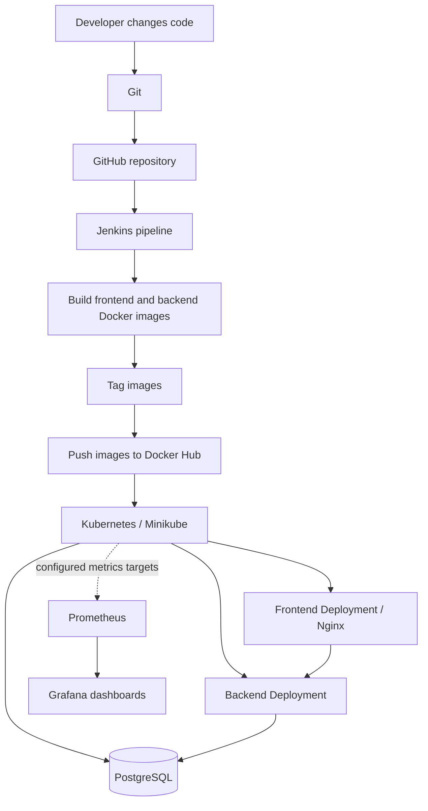

# Go Furniture — End-to-End DevOps Project

A furniture web application packaged and deployed with DevOps tooling. This project brings together source control, CI/CD, containerization, image publishing, Kubernetes deployment, and monitoring concepts.

> **Accuracy note:** The repository history confirms work with Git/GitHub, Jenkins, Docker, Docker Hub, Kubernetes/Minikube, Prometheus, and Grafana across the user's DevOps projects. Before describing Prometheus/Grafana as monitoring Go Furniture specifically, verify that the Prometheus targets and Grafana queries are connected to this project's cluster/workloads. Do not claim unverified monitoring integration or a fully successful pipeline.

## End-to-end workflow



The monitoring branch applies when Prometheus is configured to scrape metrics from the intended Kubernetes or application targets. Validate target health and dashboard queries before claiming Go Furniture-specific monitoring.

## Tools and their roles

| Tool | Role in this project workflow |
|---|---|
| Git | Track source-code changes and commits |
| GitHub | Host the repository and source used by Jenkins |
| Jenkins | Automate pipeline stages |
| Docker | Build container images for the application |
| Docker Hub | Store and distribute tagged images |
| Kubernetes / Minikube | Run and manage application workloads |
| PostgreSQL | Store furniture product data |
| Nginx | Serve the frontend and proxy configured API requests |
| Prometheus | Collect metrics from configured targets |
| Grafana | Visualize metrics from Prometheus in dashboards |

## Application components

- **Frontend:** furniture storefront.
- **Backend:** API used by the frontend.
- **Database:** PostgreSQL, initialized with `database/init.sql`.
- **Nginx:** serves frontend assets and routes `/api/` requests according to `nginx/nginx.conf`.

## Repository structure

```text
.
├── K8s/                    # Kubernetes YAML manifests
├── backend/                # Backend application and Dockerfile
├── database/
│   └── init.sql            # Database initialization and sample product data
├── docs/                   # Supporting documentation
├── frontend/               # Frontend assets and Dockerfile
├── nginx/                  # Nginx configuration
├── screenshots/            # Real project screenshots, if added
├── Jenkinsfile             # Jenkins pipeline
├── docker-compose.yml      # Local multi-container setup
├── .gitignore
└── README.md
```

## Run locally with Docker Compose

Run from PowerShell in the repository root. If your clone is at `C:\go-furniture-full-stack`, use:

```powershell
cd C:\go-furniture-full-stack
docker compose config
docker compose up --build -d
docker compose ps
docker compose logs --tail=100
```

The current Compose configuration maps the frontend to `http://localhost:8082`, backend to port `5000`, and PostgreSQL to port `5432`.

Inspect logs:

```powershell
docker compose logs -f frontend
docker compose logs -f backend
docker compose logs -f database
```

Stop services:

```powershell
docker compose down
```

This keeps the named database volume. Avoid `docker compose down -v` unless you deliberately want to delete persisted local database data.

### Credentials

The currently reviewed Compose file uses simple database credentials for development. Treat these as local-only. Before a professional/public deployment, move credentials into environment variables or a secrets manager, ensure `.env` is ignored by Git, and never commit real passwords, tokens, private keys, or kubeconfig files.

## Kubernetes / Minikube

The repository directory is `K8s/` (capital K). From the repository root:

```powershell
minikube start --driver=docker
kubectl config current-context
kubectl get nodes
Get-ChildItem .\K8s
kubectl apply -f .\K8s\
kubectl get deployments,pods,services
```

Check actual deployment names in the YAML files, then verify a rollout:

```powershell
kubectl rollout status deployment/<deployment-name>
```

Inspect failures:

```powershell
kubectl get pods
kubectl describe pod <pod-name>
kubectl logs <pod-name>
kubectl get events --sort-by=.lastTimestamp
```

To access a service, inspect its actual name and type first:

```powershell
kubectl get services
minikube service <service-name> --url
```

## Jenkins and Docker Hub CI/CD

The intended CI/CD flow is:

1. **Git:** commit and push changes to GitHub.
2. **GitHub:** provides the source repository for the pipeline.
3. **Jenkins checkout:** retrieves source code.
4. **Build:** builds frontend and backend Docker images.
5. **Tag:** tags images with explicit versions.
6. **Docker Hub:** Jenkins authenticates using a Jenkins credential and pushes versioned images.
7. **Kubernetes:** deploys the matching image versions using manifests.
8. **Validation:** checks pod health and deployment rollout status.

Before claiming the whole pipeline is fully automated, verify all of the following:

- Jenkins uses `K8s/` with correct capitalization.
- Images are built and pushed **before** deploying those versions.
- The tags pushed by Jenkins match the image tags in the Kubernetes manifests.
- Docker Hub credentials are stored in Jenkins Credentials, not hard-coded.
- Jenkins has the correct Kubernetes context and permission.
- The pipeline finishes successfully and the running pods use the expected image tags.

A successful `kubectl apply` alone does not prove that an updated image is running. Confirm with `kubectl get deployments,pods` and rollout status.

## Monitoring: Prometheus + Grafana

Prometheus and Grafana are the monitoring tools used in the user's DevOps learning work. Their exact integration with Go Furniture must be verified from the active configuration.

- **Prometheus:** scrapes metrics from configured targets and stores time-series data.
- **Grafana:** queries Prometheus and presents metrics in dashboards and panels.
- **Targets/exporters:** Kubernetes and application metrics require suitable endpoints/exporters and scrape configuration.
- **Dashboards:** show the metrics returned by actual queries; an empty panel may indicate a target, query, data source, or time-range issue.

### Monitoring validation checklist

1. Open Prometheus **Status → Targets** and confirm the relevant target is `UP`.
2. Run a query for a metric that is actually provided by your configured targets.
3. In Grafana, verify the Prometheus data source connection.
4. Open the dashboard and confirm the panels return real data for the intended cluster/target.
5. Save genuine screenshots in `screenshots/`.
6. State whether the dashboard monitors Kubernetes infrastructure, the Go Furniture application, or both. These are not automatically the same.

Do not claim application-specific metrics such as request rate or API latency unless an application metrics endpoint/exporter exposes them and Prometheus is scraping it.

## Troubleshooting guide

| Symptom | First checks |
|---|---|
| Frontend does not load | `docker compose ps`; inspect frontend/Nginx logs |
| Products are missing | Backend/database logs; verify PostgreSQL connectivity and initialized data |
| Backend cannot connect to DB | Check DB host/service name, port, credentials, and readiness |
| Kubernetes pod is not running | `kubectl describe pod <pod-name>` and `kubectl logs <pod-name>` |
| New image does not appear | Compare image tags in Jenkins, Docker Hub, and `K8s/` manifests |
| Jenkins cannot access cluster | Verify Jenkins runtime kubeconfig/context and permissions |
| Grafana panels are empty | Check Prometheus target status, query, data source, and time range |

## Security and production-readiness

This is a learning/portfolio project and should not be labelled production-ready without additional work. A production setup would need a reviewed secrets strategy, least-privilege access, TLS, health probes, resource requests/limits, image scanning, database backup/recovery tests, alerting, and operational monitoring.

## Suggested project demo

1. Open the working website and show the product listings.
2. Explain the browser → Nginx/frontend → backend → PostgreSQL flow.
3. Show Git commits and the GitHub repository.
4. Explain the Jenkins pipeline and show a successful run if available.
5. Show Docker images and matching tags in Docker Hub.
6. Show Kubernetes deployments, pods, and services.
7. Show Prometheus targets/queries and Grafana panels, explaining exactly what they monitor.
8. Describe a real issue you debugged and how you verified the fix.
