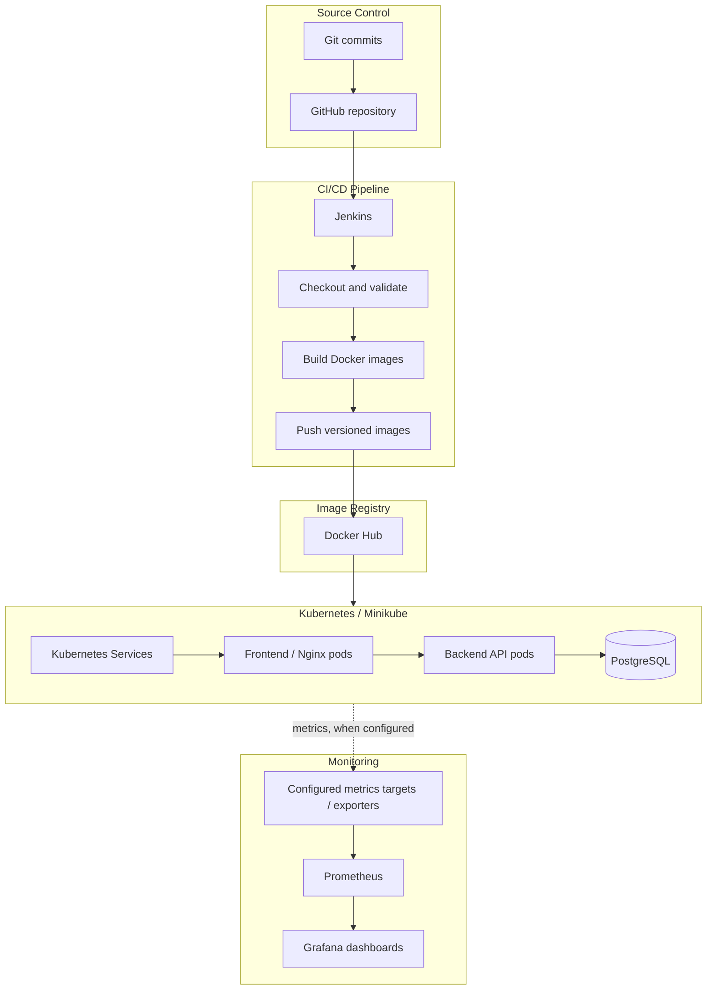

<div align="center">

# Go Furniture — DevOps Deployment & Monitoring

**An end-to-end DevOps portfolio project for a full-stack furniture web application**

[](https://github.com/bevararaghu5-netizen/go-furniture)
[](https://www.docker.com/)
[](https://www.jenkins.io/)
[](https://kubernetes.io/)
[](https://prometheus.io/)

</div>

---

## Project Overview

Go Furniture is a full-stack furniture catalogue application used to practise an end-to-end DevOps workflow. The project combines application services with containerization, CI/CD, Kubernetes deployment, and monitoring tools.

The application contains a frontend, a backend API, and a PostgreSQL database. Nginx serves the frontend and is configured to proxy API requests to the backend. The DevOps workflow uses Git and GitHub for version control, Jenkins for pipeline automation, Docker for image creation, Docker Hub as an image registry, and Kubernetes/Minikube for deployment. Prometheus and Grafana are used for metrics collection and visualization where their targets and data sources are configured.

> **Project accuracy:** This README documents the intended workflow and tools used in the project. A tool being listed here does not by itself prove that every stage is currently passing or that Prometheus is scraping Go Furniture-specific metrics. Demonstrate the current working pipeline, targets, and dashboards when presenting the project.

## Objectives

- Organize application code and configuration in a GitHub repository.
- Build and run the frontend, backend, and database as separate services.
- Containerize application components with Docker.
- Run the local multi-container setup with Docker Compose.
- Automate build, registry, and deployment steps using Jenkins.
- Store versioned application images in Docker Hub.
- Deploy and manage workloads using Kubernetes on Minikube.
- Observe configured infrastructure/application metrics with Prometheus and Grafana.
- Practise troubleshooting across the application, pipeline, container, cluster, and monitoring layers.

## Architecture



### Request flow

1. A user opens the Go Furniture website in a browser.
2. Nginx serves the frontend assets.
3. Frontend API requests are routed through the configured Nginx proxy to the backend API.
4. The backend reads product data from PostgreSQL.
5. The API response returns to the frontend and the products are displayed.

### Delivery flow

1. Code changes are committed with Git and pushed to GitHub.
2. Jenkins checks out the repository and runs configured pipeline stages.
3. Docker builds the backend and frontend images.
4. Jenkins authenticates to Docker Hub through Jenkins credentials and pushes versioned images.
5. Kubernetes manifests define the application workloads and services in Minikube.
6. Deployment status and pod health are checked after rollout.
7. Prometheus and Grafana provide observability for configured metrics targets.

## Technology Stack

| Area | Technology | Role in the project |
|---|---|---|
| Source control | Git, GitHub | Track changes and host the source repository |
| CI/CD | Jenkins | Automate configured build, publish, and deployment stages |
| Containerization | Docker | Package application components into images |
| Local multi-service setup | Docker Compose | Run frontend, backend, and PostgreSQL together |
| Image registry | Docker Hub | Store versioned container images |
| Orchestration | Kubernetes, Minikube | Deploy and manage application workloads locally |
| Web server / proxy | Nginx | Serve frontend files and route API requests |
| Database | PostgreSQL | Store furniture product records |
| Metrics collection | Prometheus | Scrape and store metrics from configured targets |
| Dashboards | Grafana | Visualize metrics from the configured data source |

## Repository Structure

```text
go-furniture/
├── K8s/                    # Kubernetes manifests
├── backend/                # Backend API and Dockerfile
├── database/
│   └── init.sql            # Database schema and sample product data
├── docs/                   # Additional documentation
├── frontend/               # Frontend assets and Dockerfile
├── nginx/
│   └── nginx.conf          # Nginx routing configuration
├── screenshots/            # Genuine project screenshots, if included
├── .gitignore
├── docker-compose.yml      # Local multi-service environment
├── Jenkinsfile             # Jenkins pipeline definition
├── LICENSE
└── README.md
```

Directory capitalization matters on Linux-based Jenkins agents: this repository uses `K8s/`. Ensure the Jenkinsfile uses the same spelling and capitalization.

## Application Components

### Frontend and Nginx
The frontend presents the furniture catalogue. Nginx serves the frontend and routes configured `/api/` requests to the backend service.

### Backend API
The backend handles API requests and retrieves product data from PostgreSQL. Its Dockerfile uses a Node.js Alpine image and starts the application using the configured npm start script.

### PostgreSQL
PostgreSQL stores the product records. `database/init.sql` is used to initialize the database when the database volume is first created. Initialization scripts are generally not re-run automatically against an already initialized persistent data volume.

### Persistent data
The Compose configuration uses a named PostgreSQL volume. Avoid `docker compose down -v` unless you deliberately intend to delete the Compose-managed database volume. Back up data before destructive database or volume changes.

## Run Locally with Docker Compose

Run commands from the project root in PowerShell.

```powershell
cd C:\go-furniture-full-stack
docker compose config
docker compose up --build -d
docker compose ps
docker compose logs --tail=100
```

Open the frontend using the current Compose port mapping:

- Frontend: `http://localhost:8082`
- Backend API: `http://localhost:5000`
- PostgreSQL: port `5432` (database connection, not a browser page)

Useful commands:

```powershell
docker compose logs -f frontend
docker compose logs -f backend
docker compose logs -f database
docker compose down
```

`docker compose down` stops and removes containers and the default network but normally preserves the named database volume. Do not use `-v` unless you intend to remove that volume.

### Development credentials

The current Compose configuration has database credentials declared directly in YAML. Treat these as local development values only. Before a public or production deployment, move credentials into environment variables or a secret-management system, keep `.env` out of Git, and rotate any real credentials that may have been exposed.

## Jenkins CI/CD

The Jenkinsfile defines the pipeline. The intended lifecycle is:

1. **Checkout** — retrieve source code from GitHub.
2. **Validate** — check required tooling and access to the target Kubernetes context.
3. **Build** — build the backend and frontend Docker images.
4. **Authenticate** — use Jenkins Credentials for Docker Hub login.
5. **Publish** — tag and push the images to Docker Hub.
6. **Deploy** — apply the Kubernetes manifests.
7. **Verify** — inspect rollout status and running pods.

### Pipeline validation requirements

Before describing the pipeline as fully automated, verify all of the following:

- The actual Jenkins run completes successfully through the final stage.
- Image tags pushed to Docker Hub match the image references in `K8s/` manifests.
- Build and push stages happen before deployment of those image versions.
- The Jenkinsfile uses `K8s/` with correct capitalization.
- Docker Hub credentials are stored in Jenkins Credentials, not hard-coded.
- `kubectl rollout status` succeeds for the intended deployments.
- The running pods use the expected image versions.

A successful `kubectl apply` only confirms that Kubernetes accepted the configuration; it does not by itself confirm that the new version is healthy.

## Docker and Docker Hub

Docker images package the application components. Docker Hub stores tagged images so the deployment environment can pull a particular version.

Examples of image names used during project work include:

- `raghu434/go-furniture-backend:1.0`
- `raghu434/go-furniture-frontend:1.0`, with later frontend tags also used during troubleshooting

**Use the actual image tags shown in the latest successful Jenkins run and the current Kubernetes manifests.** Do not assume that an earlier tag is still the deployed version.

## Kubernetes Deployment

The `K8s/` directory contains the manifests for the application workloads and services. Minikube provides a local Kubernetes cluster for development and practice.

Run from PowerShell in the repository root:

```powershell
minikube start --driver=docker
kubectl config current-context
kubectl get nodes
Get-ChildItem .\K8s
kubectl apply -f .\K8s\
kubectl get deployments,pods,services
```

Inspect an unhealthy pod:

```powershell
kubectl describe pod <pod-name>
kubectl logs <pod-name>
```

Check rollout status using the actual deployment names shown by `kubectl get deployments`:

```powershell
kubectl rollout status deployment/<deployment-name>
```

Access a service using its real name:

```powershell
minikube service <service-name> --url
```

Use `kubectl get services` to identify the service names and types. NodePort values and local Minikube URLs may change.

## Monitoring: Prometheus and Grafana

Prometheus and Grafana are the monitoring tools used in the DevOps work.

### Prometheus
Prometheus scrapes and stores time-series metrics from configured targets. Target configuration and exporters determine which metrics are available. Kubernetes-related metrics require the relevant exporters or metrics endpoints to be deployed and scraped.

### Grafana
Grafana uses Prometheus as a data source to display metrics through dashboard panels and queries. Dashboards can help observe resource use, workload state, and other metrics exposed by the configured targets.

### Monitoring validation checklist

- Open Prometheus **Status → Targets** and verify that the intended target is `UP`.
- Run a query relevant to the metrics that are actually available.
- Confirm the Grafana Prometheus data source test succeeds.
- Verify dashboard panels show current data for the selected time range.
- State clearly whether the dashboard monitors Kubernetes infrastructure, application metrics, or both.
- Add only genuine screenshots captured from the working environment.

> A Grafana dashboard from a separate Kubernetes practice project does not automatically mean Go Furniture itself is monitored. Claim Go Furniture-specific monitoring only after verifying that Prometheus is scraping targets connected to the Go Furniture environment.

## Troubleshooting and Lessons Learned

The project involved troubleshooting application and deployment configuration, including frontend/API routing, product data availability, container image versions, and Kubernetes configuration.

A useful troubleshooting method is:

1. Reproduce the issue and note the exact symptom.
2. Check container or pod status.
3. Inspect logs and configuration.
4. Verify service names, ports, image tags, and database connectivity.
5. Apply the smallest appropriate correction.
6. Re-test the application and confirm the result.

For example, when product listings are missing, check the frontend request, backend API response, database contents, and service connectivity rather than assuming the issue is in the frontend alone.

## Security and Production Readiness

This is a portfolio and learning project. Using Docker and Kubernetes does not automatically make an application production-ready. A production deployment would also need reviewed secrets management, least-privilege permissions, TLS, resource requests and limits, health probes, image scanning, database backups, monitoring alerts, and tested recovery procedures.

## Project Demonstration

The technical walkthrough presents the application and its DevOps lifecycle:

1. **Application architecture** — demonstrate the furniture catalogue and explain the frontend, backend, and database request flow.
2. **Source control** — present the GitHub repository, commit history, and project structure.
3. **CI/CD automation** — explain the Jenkins stages and show a successful pipeline run when available.
4. **Container image lifecycle** — demonstrate Docker builds and matching versioned images in Docker Hub.
5. **Kubernetes orchestration** — show deployments, pods, services, and rollout verification in Minikube.
6. **Monitoring and observability** — show Prometheus target health and queries, then Grafana panels; identify the exact targets and metrics being monitored.
7. **Troubleshooting and validation** — explain a real issue, the diagnosis, the corrective action, and how the fix was verified.
8. **Technical outcomes** — summarize practical experience with version control, CI/CD, containers, orchestration, database integration, monitoring, and deployment troubleshooting.

The objective is to demonstrate a clear understanding of the application lifecycle, from source-code management and image creation through deployment, observability, and validation.
